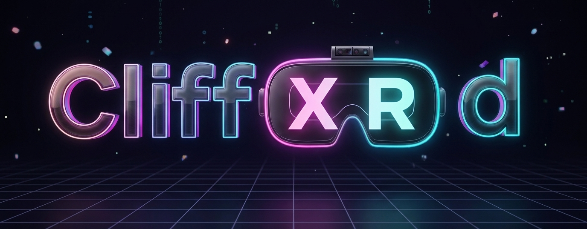
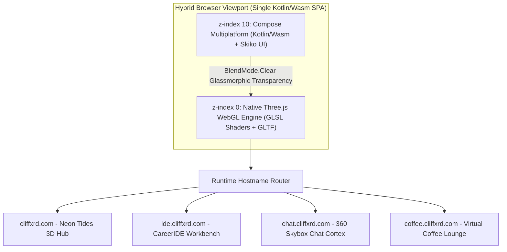

<div align="center">

<picture>
  <source media="(prefers-color-scheme: dark)" srcset="./assets/banner-dark.png">
  <source media="(prefers-color-scheme: light)" srcset="./assets/banner-light.png">
  
</picture>

</div>

> [!TIP]
> <details>
> <summary> <sub> How to create theme-adaptive images, like this one (plus banner archive) </sub> </summary>
>
> <sub>This banner image changes automatically depending on your GitHub preference for light or dark mode using the HTML5 <code>&lt;picture&gt;</code> element:</sub>
>
> ```markdown
> <picture> <!-- Example: -->
>  <source media="(prefers-color-scheme: dark)" srcset="URL_DARK_THEME_IMG"> <!-- used when GitHub dark mode is active -->
>  <source media="(prefers-color-scheme: light)" srcset="URL_LIGHT_THEME_IMG"> <!-- used when GitHub light mode is active -->
>   <!-- fallback with accessibility text support -->
> </picture>
> ```
>
> <sub>For more, see <a href="https://docs.github.com/en/get-started/writing-on-github/getting-started-with-writing-and-formatting-on-github/quickstart-for-writing-on-github#adding-an-image-to-suit-your-visitors">Adding an image to suit your visitors</a>. Banner gallery: <a href="./assets/banner-dark.png">Neon Tides Dark</a> · <a href="./assets/banner-light.png">Neon Tides Light</a> · <a href="./assets/banner-neon-tides-sunset.png">Neon Tides Sunset Edition</a> · <a href="https://github.com/user-attachments/assets/6f03ab33-df24-4066-a087-fc963e4245e9">Classic Matrix Dark</a> · <a href="https://github.com/user-attachments/assets/75bdbdb4-5467-4086-9273-9c897da67a23">Classic Matrix Light</a>.</sub>
> </details>

# Hey there! I'm Cliff 👋

## 👨🏼‍💻 Senior Android & Multiplatform Engineer | UI/UX & Design Systems | Creative Technologist

<p>
  <a href="https://cliffxrd.com"></a>
  <a href="https://ide.cliffxrd.com"></a>
  <a href="https://cv.cliffxrd.com"></a>
  <a href="https://coffee.cliffxrd.com"></a>
  <a href="https://chat.cliffxrd.com"></a>
  <a href="https://linkedin.com/in/cliffordhattingh"></a>
</p>

I'm a Senior Android & Multiplatform Engineer operating between **London, UK** 🇬🇧 and **Cape Town, South Africa** 🇿🇦, with a passion for bridging the gap between intricate systems engineering and emotionally resonant, intuitive design.

My engineering perspective is shaped by an **18-Year Dual Heritage**: **8 years** of 3D spatial environment modeling, skeletal rigging, and event-driven Lua scripting (*Kaneva Virtual World*), followed by **10+ years** of native enterprise Android systems architecture (**Warner Bros. Discovery / Max**, **discovery+**, **eventcloud**). That early spatial foundation translates directly into how I engineer complex Jetpack Compose layout math, custom `DrawScope` canvases, non-touch focus graphs, and fluid multi-device adaptations today.

---

## 🏆 Flagship Engineering Receipts

- 🎬 **Max Greenfield Rebuild & Multi-Device Architecture (Warner Bros. Discovery)** — Core member of the select foundational team that built the all-new **Max** application completely from scratch in **5 months**, unifying the full feature sets and catalogs of legacy **HBO Max** and **discovery+** for **100M+ day-one subscribers**. Owned the UI architectural vision and **AppTheme** JSON-driven token design system (custom `CompositionLocals` across window size classes), mentored cross-functional teams transitioning to Jetpack Compose, engineered the **7-tier Adaptive Breakpoint System** (foldables, tablets, large screens, Android TV), and built **FocalConductor** for non-touch D-pad/keyboard focus navigation—directly contributing to Max winning **Google Play's "Best Multi-device App of 2024"** and **Google Large Screen Certification**.
- ♿ **Ecosystem Accessibility Fix & Google London HQ Collaboration** — Led the resolution of a critical ecosystem accessibility crash between **Jetpack Compose** and **Samsung Screen Reader (TalkBack)** that had gone unresolved by a 25-person team. Drove cross-company collaboration with **Sa-ryong Kang (Google DevRel Lead)** and Samsung engineers to deploy a platform-wide patch benefiting all Compose apps worldwide. Resolving this conflict directly led to organizing **3 private technical workshops with Google** and receiving direct 1-on-1 hands-on training from **Ben Weiss at Google London HQ** on recomposition optimization and **Macrobenchmark** profiling.
- 🎙️ **Co-Inventor — Multimodal Conversational AI & Media Accessibility (Home Box Office, Inc.)** — Co-architected an AI-driven, voice-first media discovery engine for streaming platforms integrating speech-to-text, vector similarity search, cross-encoder re-ranking, and LLM-driven personalized audio synthesis for visually impaired subscribers. Awarded **2nd Place in the WBD Global Hackathon (Dec 2024)** and **listed as co-inventor for the patent currently being registered** (assigned to *Home Box Office, Inc.*).
- 🏅 **discovery+ Olympic Broadcasts & Enterprise White-Label Scale** — Selected as the inaugural Android representative on the cross-functional **Global Discovery Design System** team (Android, iOS, Web, Design), unifying design tokens across platforms with **zero UI bugs** reported from design components during the **Tokyo 2020 Olympic Games** live broadcast, and led the early production rollout of Jetpack Compose (2021) ahead of the **Beijing 2022 Winter Olympics**. Previously at **eventcloud**, published and managed **25+ white-label event apps** (*Taxify/Bolt*, *Superdrug UK*, *Dubai Happiness Journey*, *RDPetro*) from a single multi-flavor Gradle codebase, and rescued a critical launch by stripping bloated libraries and converting assets to WebP—reducing binary size by **77% (98MB → 22MB)** and cutting fatal crashes by **85%**.

---

## 🧠 My Philosophy: Depth Over Velocity & Human Semiotics

My core belief is that the best technology feels like magic. It's not just about writing clean code, but about understanding the human at the other end of the screen. I am a strong proponent of **Kotlin Multiplatform**, particularly **Compose Multiplatform**, to create cohesive and elegant experiences across all devices.

> *"The role of genius is not to complicate the simple, but to simplify the complicated."*
> — Criss Jami

In an industry often obsessed with superficial sprint velocity, speed easily becomes a deceptive proxy for quality. When teams optimize exclusively for *"done"* instead of *"sound"*, technical debt is institutionalized. My engineering ethos is anchored in **Depth Over Velocity** and two governing convictions:

- **Craft Invariant:** *"The celebration of mediocrity will be the downfall of society."*
- **Operating Premise:** *"There is a better way; I just need to engineer it by creating tomorrow's code, today."*

True technical breakthroughs require depth, incubation, and craftsmanship—because enduring speed is the byproduct of structural integrity, never hasty compromise.

My approach to UI/UX is rooted in a deep understanding of **human psychology, cultural semiotics, and color theory** (studied alongside Computer Science and Film & Media at the **University of Cape Town**). The goal is to craft interfaces that are not just intuitive, but emotionally resonant—leveraging established visual language (like the urgency of red, the calm trust of blue, or the extra-spectral bridge of magenta) to guide the user experience on a subconscious level, making it feel effortless and natural.

---

## 🌌 Live Interactive Spatial Ecosystem (`cliffxrd.com`)

Rather than hosting a static web resume, I engineered a consolidated **Kotlin Multiplatform (Kotlin/Wasm) + Compose Multiplatform + Three.js** spatial web portal deployed from a single compiled Wasm binary across multiple runtime-resolved subdomains:

<table>
  <tr valign="top">
    <td width="50%" valign="top">
      <h3 align="center">🌊 Neon Tides 3D Spatial Hub</h3>
      <p align="center">
        <a href="https://cliffxrd.com">
          
        </a>
      </p>
      <p>
        A hybrid <strong>Kotlin/Wasm + Compose Multiplatform + Three.js</strong> spatial web experience. Features custom GLSL water and golden-hour sky shaders, low-poly GLTF shoreline palms, a 3-regime aspect-ratio camera &amp; frustum shoreline solver, glassmorphic Skiko UI surfaces (<code>BlendMode.Clear</code>), and a 3D CoverFlow portal carousel.
      </p>
      <p align="center">
        <code>Kotlin/Wasm</code> · <code>Three.js</code> · <code>GLSL</code> · <code>KUDUS</code>
      </p>
    </td>
    <td width="50%" valign="top">
      <h3 align="center">💻 CareerIDE — Dark Islands Workbench</h3>
      <p align="center">
        <a href="https://ide.cliffxrd.com">
          
        </a>
      </p>
      <p>
        An interactive <strong>JetBrains Islands Dark</strong> 3-pane IDE built in <strong>Compose Multiplatform (WasmJs)</strong> (also accessible at <a href="https://bio.cliffxrd.com">bio.cliffxrd.com</a>). Explore my 18-year engineering chronology through syntax-highlighted Kotlin source models (<code>About.kt</code>, <code>Experience.kt</code>, <code>Projects.kt</code>), draggable split panes, dynamic font scaling, and live rich previews.
      </p>
      <p align="center">
        <code>Compose Wasm</code> · <code>Islands Dark</code> · <code>Custom Vectors</code> · <code>UDF</code>
      </p>
    </td>
  </tr>
</table>



---

## 🛠️ My Tech Stack & Design Systems Matrix

A glimpse into the languages, system frameworks, and spatial tools I work with and love to use:

<table>
  <thead>
    <tr>
      <th width="25%" align="center">📱 Core &amp; Multiplatform</th>
      <th width="25%" align="center">🏛️ Android &amp; Architecture</th>
      <th width="25%" align="center">🎨 Design, 3D &amp; Spatial Web</th>
      <th width="25%" align="center">⚡ AI, Cloud &amp; Tooling</th>
    </tr>
  </thead>
  <tbody>
    <tr valign="top">
      <td width="25%" align="center" valign="top">
        <br/>
        <br/>
        <br/>
        <br/>
        <br/>
        <br/>
        
      </td>
      <td width="25%" align="center" valign="top">
        <br/>
        <br/>
        <br/>
        <br/>
        <br/>
        <br/>
        
      </td>
      <td width="25%" align="center" valign="top">
        <br/>
        <br/>
        <br/>
        <br/>
        <br/>
        <br/>
        
      </td>
      <td width="25%" align="center" valign="top">
        <br/>
        <br/>
        <br/>
        <br/>
        <br/>
        <br/>
        
      </td>
    </tr>
  </tbody>
</table>

---

## 🌱 What I'm Currently Focused On

- 🧠 **Distributed & Multimodal AI (`HyveAi` / Gemini SDK)** — Researching decentralized AI model computation on Android using the **Gemini SDK** (securing an initial angel investment offer from technical proof-of-concept) alongside voice-first accessibility architectures.
- 🐾 **GeoPaws (On-Device Vision & Low-Power Geolocation)** — Engineering a location-based pet utility utilizing battery-efficient background geolocation, Firebase realtime synchronization, and on-device computer vision (`TFLite`).
- 🌐 **Kotlin/Wasm & KUDUS Universal Design System** — Expanding cross-platform design tokens, adaptive window-size engines, and hybrid **Three.js + Compose Multiplatform Wasm** rendering across [`cliffxrd.com`](https://cliffxrd.com) and [`ide.cliffxrd.com`](https://ide.cliffxrd.com).
- 📱 **Adaptive Multi-Device & Extended Reality (XR) UI** — Crafting fluid interfaces for foldables, tablets, non-touch TV surfaces, and spatial computing.
- 🖨️ **3D Printing & Rapid Prototyping** — Designing and fabricating custom 3D-printed models and tinkering with game design in my spare time.

---

## 📫 Let's Connect!

I'm always open to collaborating on interesting projects or just chatting about tech, design systems, spatial UI, or a great cup of coffee ☕.

<p align="left">
  <a href="https://cliffxrd.com"></a>
  <a href="https://ide.cliffxrd.com"></a>
  <a href="https://coffee.cliffxrd.com"></a>
  <a href="https://chat.cliffxrd.com"></a>
  <a href="https://cv.cliffxrd.com"></a>
</p>
